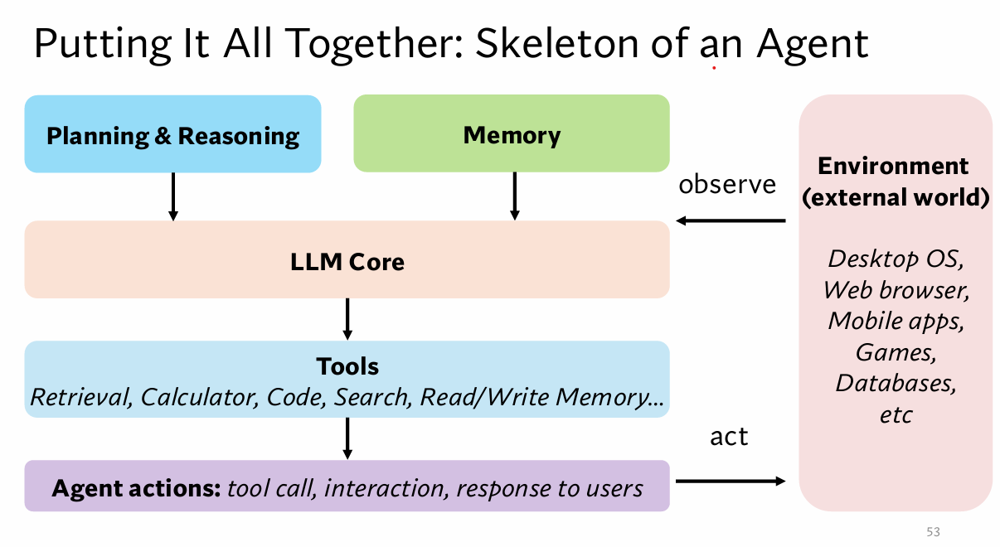

# Week 1 

LLM era: reasoning and tool use
architecture of an agent:
 llm memory planning and reasoning tools environment

ReAct is better thant CoT since react handles hallucination better

Self-Consistency

prompt a language model using chain-of-thought prompting, and generate a diverse set of reasoning paths, aggregate by choosing the most consistent answer in the final answer set.

Reflexion

agents verbally reflect on task feedback signals, then maintain their own reflective text to induce better decision-making

key components:

Planning and Reasoning

Memory

* episodic memory: experience
* semantic memory: facts
* procedural memory: skills'

skeleton of an agent:

Key Challenges in building agents

Reliability
    consistency: do agents produce same outcome when given the same task twice?
    robustness: how do agents respond to small, realistic shifts in prompts, tools, etc?
    predictable: when agents fail, do they fail in legible and recoverable way?

