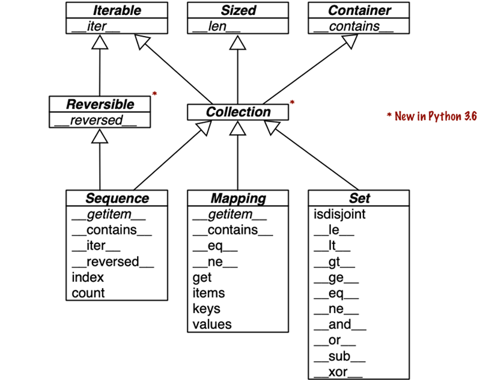

# Python data model

[] is implicitly supported by the __get_item__ special method

__len__
__get_item__

leverage standard library functions like random.choice()

by implementing __get_item__, the deck is also iterable:
for card in deck:
  print(card)

special methods are meant to be called by python interpreter
but if the class is instance of pyvarobject, there is a shortcut to use the 
ob_size field

you usually only need to call __init__ to invoke the initializer of the superclass in your own __init__ implementation

## Emulating numeric types

class Vector:

    def __init__(self, x=0, y=0):
        self.x = x
        self.y = y

    def __repr__(self):
        return f'Vector({self.x!r}, {self.y!r})'

    def __abs__(self):
        return math.hypot(self.x, self.y)

    def __bool__(self):
        return bool(abs(self))

    def __add__(self, other):
        x = self.x + other.x
        y = self.y + other.y
        return Vector(x, y)

    def __mul__(self, scalar):
        return Vector(self.x * scalar, self.y * scalar)

## string representation

__repr__

## boolean value of a custom type

__bool__

## Collection API

__iter__
__contains__
__reversed__

belong to the collections.abc module

## Summary
By implementing special methods, your objects can behave like the built-in types, enabling the expressive coding style the community considers Pythonic.